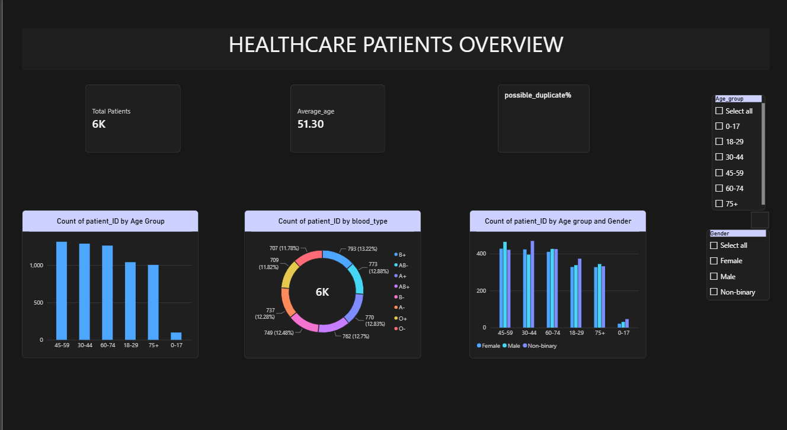

# Healthcare Patient Data Analysis & Dashboard

An end-to-end analysis of 6,000 patient records: data validation in Python, SQL analysis in MySQL, and an interactive Power BI dashboard.

**Business question:** Who makes up this patient population, and is the data clean enough to trust for reporting?

**Tools:** Python (Pandas), MySQL, Power BI

---

## Key Findings

| Area | Finding |
|---|---|
| Dataset | 6,000 patient records; ages 16 to 86, average 51.3 |
| Data quality | No missing values, invalid IDs, or exact duplicates |
| Possible duplicates | 13 pairs of records share the same name and date of birth and were flagged for review |
| Largest age group | 45-59: 1,312 patients (about 21.9% of all records) |
| Smallest age group | Under 18: 98 patients (about 1.6%) |
| Gender | Nearly even: Non-binary 34.4%, Male 33.3%, Female 32.3% |
| Blood type | Evenly spread: B+ is the most common (793 patients, about 13.2%) and O- the least (707, about 11.8%) |

## Insights and Recommendations
- **Focus on the middle-aged and older groups.** The 45-59 group is the largest in the dataset, so reporting and capacity planning for this population should start there.
- **Review the 13 flagged pairs before reporting patient counts.** They match on name and date of birth only, so they are possible duplicates, not confirmed ones.
- **Treat the results with care.** Gender and blood type are almost perfectly evenly distributed, which is unusual in real populations and suggests the dataset is synthetic.

## Approach

**1. Data cleaning and validation (Python / Pandas)**
Checked 6,000 records for missing values, ID formats, invalid values, and date errors, and flagged possible duplicate records.

**2. Feature engineering**
Created age, age group, ABO blood group, and Rh factor to profile the patient population.

**3. SQL analysis (MySQL)**
Wrote queries using CTEs, window functions, and self-joins. A duplicate-detection query originally timed out; adding a composite index made it run almost instantly.

**4. Dashboard (Power BI)**
Built an interactive dashboard with KPI cards, age-group and blood-type charts, and gender and age slicers so the data can be filtered.

## Limitations
- The data appears synthetic, so findings describe this dataset only and should not be generalized to real patients.
- Duplicate detection uses name and date of birth only, so flagged pairs need manual review.
- The analysis is descriptive: it shows who is in the dataset, not clinical outcomes.

## Author
**Soujanya Boginipeta**
